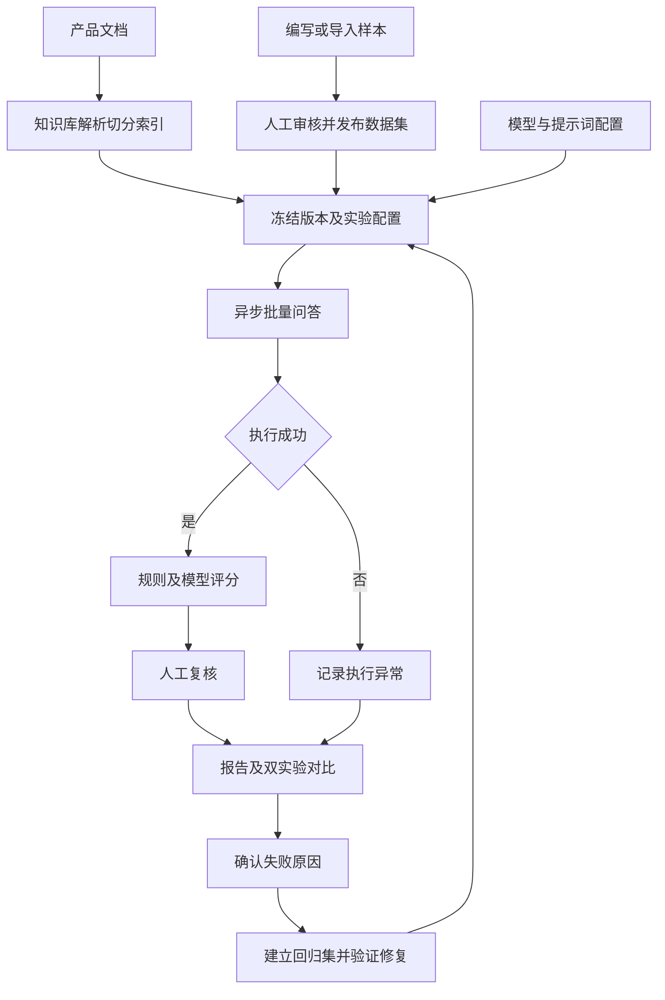

# 知衡 RAG 问答质量评测平台需求规格说明书

## 1. 文档信息

版本：V1.0；日期：2026-11-02；范围：单组织练习与面试演示系统。项目以模拟订单产品为评测对象，重点建设评测平台，被测助手仅保留单轮检索问答能力。

## 2. 业务目标

管理可追溯的知识库和评测集，将版本化资产与模型配置组成实验，批量测试 RAG，解释失败原因并验证修复。首版最终应完成50条人工审核样本、两组Top K配置实验、一份对比报告和一次回归评测。不合成总分，各维度独立展示。

## 3. 用户与权限

| 角色 | 权限 |
| --- | --- |
| 管理员 | 用户、模型凭证、系统及业务配置 |
| 测试人员 | 知识库、样本、实验、归因和回归集 |
| 复核人员 | 样本审核、评分修正和归因确认 |
| 只读用户 | 已发布资产和报告查看 |

允许兼任角色；审核、评分修正必须记录操作人、时间、理由。首批代码为登录用户共享工作区，细分角色将在权限迭代完成。

## 4. 业务流程与模块

模块分为知识资产、被测助手、评测资产、执行调度、评分复核、报告对比、失败回归、系统配置八部分。

## 5. 功能需求

### 5.1 知识库（KB）

- KB-01：按产品和业务版本管理知识库，支持多个知识修订版本。
- KB-02：上传UTF-8 Markdown/TXT，校验后缀、编码、空内容与大小；单文件初始上限2MB。
- KB-03：展示原文、解析结果、标题路径、片段原文与位置。
- KB-04：配置分段长度100～4000字符、重叠长度0至分段长度减1；预览切分结果。
- KB-05：异步执行索引，显示进度和失败原因；索引完整成功后才允许发布。
- KB-06：已发布版本不可编辑或删除；变更生成新版本；历史片段和来源保持可查。

### 5.2 被测助手（RAG）

- RAG-01：选择知识库版本、供应商、模型、提示词版本及Top K（1～20）。
- RAG-02：输入问题，输出回答、引用、检索排序及原始片段。
- RAG-03：保存配置快照、分阶段耗时、输入输出Token及异常；供应商未返回Token时置空，不估造。
- RAG-04：资料不足时明确拒答；无片段直接拒答，证据不足的判断规则须版本化。
- RAG-05：隔离模型供应商；生成模型、评分模型、Embedding模型独立配置。

### 5.3 评测集（DS）

- DS-01：样本含稳定标识、问题、参考答案、证据、类型、应否拒答、必须条件、禁止条件、产品适用版本及审核状态。
- DS-02：手工维护、JSON导入、导入错误定位；重复标识阻止导入。
- DS-03：发布前所有样本通过人工审核；非拒答样本应有参考证据；拒答样本允许无证据。
- DS-04：发布后冻结内容；编辑产生新版本。AI生成内容进入待审核，不允许自动发布。
- DS-05：证据保存文档名、原文位置与原文，片段ID仅作辅助映射，支持不同切分方案对比。

### 5.4 实验（EX）

- EX-01：实验绑定已发布资产，冻结数据、检索、生成、评分和执行参数。
- EX-02：Celery批量执行，展示总数、完成数、执行异常、质量失败和待复核数。
- EX-03：支持有限并发、超时、退避重试、失败样本重跑；保留每次尝试。
- EX-04：重复消息不重复计数；发布失败可恢复；Worker中断可恢复。
- EX-05：问答与评分分别记录状态，评分失败不能覆盖成功的问答结果。

### 5.5 评分与复核（EV）

| 维度 | 判定与输出 |
| --- | --- |
| 检索命中 | 参考证据是否覆盖，展示命中与遗漏证据 |
| 正确性 | 必须/禁止条件检查，加语义评分与理由 |
| 有据性 | 回答逐项结论与片段的支持关系 |
| 引用有效性 | 来源存在性和结论支持性分别判定 |
| 拒答 | 应拒答与实际拒答交叉统计 |
| 效率 | 耗时、Token与异常 |

模型评分返回结构化判定、理由及证据ID；结构异常记为评分失败。无法判断记为待复核。规则失败可直接标为不达标；规则通过不能替代语义正确性。人工修正追加保存，报告默认使用最新有效复核，同时可查看原始评分。

### 5.6 报告与对比（RP）

- RP-01：展示分维度指标、统计分母、各问题类型表现、失败和待判定数量。
- RP-02：执行成功率=问答执行成功数/总样本数；执行失败单列，不能作为语义错误。
- RP-03：某维度通过率=该维度通过数/该维度有效判定数；无有效判定显示空值。
- RP-04：证据召回按每条样本标注证据计算，再展示有证据样本的宏平均；无证据样本不计入分母。
- RP-05：正确拒答率使用应拒答样本为分母；误拒答率使用不应拒答样本为分母。
- RP-06：比较两次实验的配置、指标、逐条回答，标记新增失败、已修复、持续失败、持续通过；异常和待复核单列。
- RP-07：同版本优先；跨版本只对齐标识与内容一致的样本；导出CSV/JSON，CSV防公式注入。

### 5.7 失败与回归（RG）

归因包含文档缺失/过期、解析切分异常、检索遗漏、生成理解或遗漏、引用错误、拒答错误、执行异常、样本错误、评分器误判。允许主因和次因。AI建议须人工确认。回归样本保存原实验、原样本、原因及修复条件，不破坏原始数据集。

## 6. 页面需求

概览、知识库、问答调试、评测集、实验任务、结果详情、实验对比、回归集、系统配置。结果详情集中展示问题、参考答案、检索证据、回答、原始评分、复核和归因。

## 7. 非功能需求

- 默认所有业务API需要身份认证；凭证不进入前端与代码库。
- 产品文档作为不可信输入，提示词不得执行文档内指令。
- MySQL作为事实来源，Redis只负责调度，索引不能跨知识库版本混用。
- 目标容量：100条样本/实验、并发1～5起步；最终容量与耗时以压测环境为准。
- 模型调用不承诺确定性；保存模型标识、参数及返回版本信息。
- 本地离线模式用于功能验证，不能用于证明真实RAG效果。

## 8. 验收用例

| 编号 | 操作 | 期望 |
| --- | --- | --- |
| AC-01 | 上传四份模拟产品资料并发布 | 原文、片段、版本可查 |
| AC-02 | 导入50条待审核样本并尝试发布 | 阻止发布；审核完成后可发布 |
| AC-03 | 同一批样本执行Top K=3与5 | 两组实验配置与结果完整保存 |
| AC-04 | 制造模型超时与错误回答 | 分别计为执行异常与质量失败 |
| AC-05 | 人工修正评分 | 原始评分保留，报告采用复核结果 |
| AC-06 | 对比实验并建立回归集 | 能定位新增/修复失败并再运行 |
| AC-07 | 修改草稿或创建新版本 | 不影响历史实验快照 |

## 9. 暂缓范围

多轮对话、PDF/Word/OCR、联网检索、自动调参、多租户计费、无需审核的AI样本发布。通用Web/API自动化平台另设后续模块，本项目先使用pytest、Playwright、Locust测试自身。
