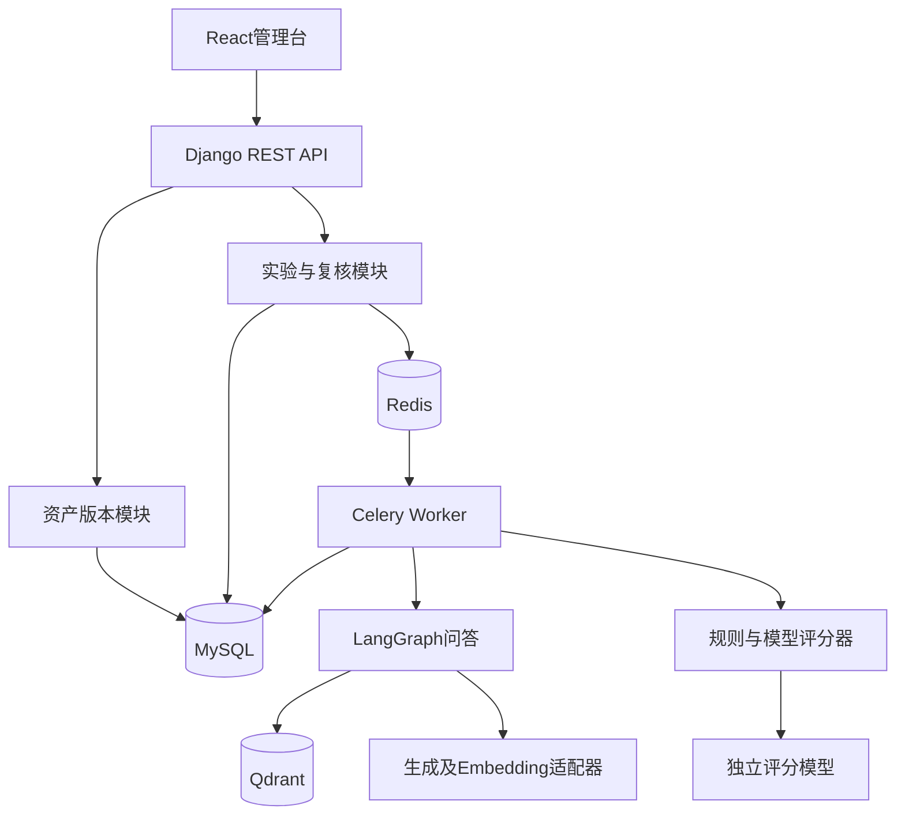
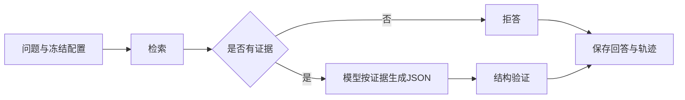

# 概要技术设计

## 1. 技术基线

React 18 + TypeScript + Vite；Django 5.0 + DRF + Python 3.12；MySQL 8；Celery + Redis；LangGraph；Qdrant；通义千问/DeepSeek兼容接口。Python包仅安装在项目.venv，前端包安装在frontend/node_modules。

生成模型、评分模型与向量模型独立适配。首批实现通义兼容接口生成及Embedding；DeepSeek生成可配置兼容地址，但其向量服务不可假定存在，需要独立Embedding连接器。

## 2. 架构与职责

模块拆分：core为首批业务聚合应用；业务稳定后拆为accounts、knowledge、datasets、rag、experiments、evaluation、reports。避免初期跨应用迁移成本，服务逻辑已独立于视图。

## 3. 版本与可重复性

知识资产与评测集草稿可编辑，发布后不可变。实验保存完整数据快照、切分片段、Top K、模型、提示词正文与版本、规则版本。历史详情读取快照，不回查可变资料。后续补充供应商版本、Embedding参数、评分器参数、检索阈值、随机种子与调用尝试记录。模型输出不能保证逐字重复。

## 4. 知识处理与检索

当前解析保留Markdown/TXT原文，按字符窗口切分，记录文档名、字符偏移与内容哈希标识。标题语义切分与异步索引为下一迭代。正式方案：解析→切分预览→异步Embedding→写入临时collection→校验数量→发布索引别名；失败索引不可用于实验。

首批live模式按Embedding模型和片段内容生成collection名称，首次问答惰性构建Qdrant索引。该方式仅适合串行验证；并发建索引、部分写入恢复尚未实现，正式批量使用前必须改为发布时索引。mock模式采用字符匹配和原文摘录，始终在结果中标记mock。

## 5. 问答编排

参考答案不进入被测链路。JSON包含answer、refused、citations。无检索结果直接拒答；存在检索结果仍可能证据不足，由生成提示词约束，后续加入独立充分性判断。来源存在检查与语义支持检查分离。

## 6. 异步执行

当前实验入库提交后投递Celery，数据库条件更新原子认领实验，逐条串行问答与规则评分。状态：pending→running→completed；入队失败为dispatch_failed；样本pending→succeeded/execution_failed。completed表示执行结束，不表示质量通过。

目标执行机制：事务内写出站事件，调度器可靠投递；实验拆分样本任务；唯一约束(experiment,sample_id)防重复结果；数据库认领加租约和心跳，超时扫描恢复；每次尝试单独保存。并发由队列及Worker控制，调用超时、限流重试与业务失败区分。首批调用SDK最多重试2次，尚未提供样本级重跑与崩溃恢复。

## 7. 评分与报告

当前规则检查必须/禁止条件、引用存在、拒答标签、参考证据原文覆盖；正确性与有据性为空，进入人工复核。证据完整跨片段时当前匹配会漏计，后续改为来源区间覆盖。

目标评分模型单独调用，输出维度状态、理由和证据列表，强制校验引用属于本次检索证据。评分异常可独立重试。报告按维度有效判定数计算，不把未知视为0，也不强行合成总分。

复核采用追加记录，原始评分保留；当前报告采用最新复核的整体通过判定，后续细化到各维度。两组对比按稳定样本ID与内容哈希对齐。

## 8. 安全与运行

DRF Token/Session认证；开发前端令牌仅存在页面内存。环境变量存模型凭证，异常仅返回类型，不回传第三方原始异常。发布资产禁改，Django Admin业务资产仅只读，避免绕过约束。生产部署需补充分角色权限、操作审计、HTTPS、密钥管理、接口限流、备份恢复。

当前遵从指定Django5.0版本；公网生产部署前需要单独评审该版本维护状态与升级方案。

## 9. 目录说明

- backend/config：环境配置、路由、Celery入口。
- backend/apps/core：模型、序列化校验、视图、任务和RAG服务。
- backend/tests：核心业务与集成测试。
- frontend/src：React管理台。
- infra：MySQL/Redis/Qdrant开发服务。
- examples/order-system：模拟文档与待人工审核样本。
- tests/e2e、tests/load：界面与并发验证入口。
- docs：交付文档；scripts：开发辅助脚本。

## 10. 官方参考

- [Django 5.0 Python兼容性](https://docs.djangoproject.com/en/5.0/releases/5.0/)
- [LangGraph StateGraph](https://reference.langchain.com/python/langgraph/graph/state)
