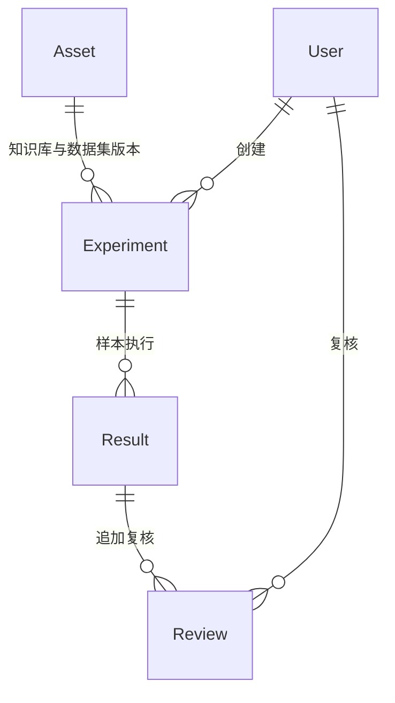

# 数据库设计

## 1. 约定

业务库zhiheng_rag_eval，MySQL 8、utf8mb4、严格模式、Django事务。主键为BigAutoField；时间按UTC存储，界面按Asia/Shanghai显示。Django迁移文件是当前结构的可执行来源。

## 2. 模块拆分与关系

业务流程：草稿Asset→校验并发布→实验冻结快照→逐条Result→追加Review→报告采用最新复核。首批使用聚合JSON，后续按文档、样本、轨迹拆表，不将其描述为已完成的独立实体。

## 3. 当前数据字典

### core_asset：版本化业务资产

| 字段 | 类型 | 说明 |
| --- | --- | --- |
| id | bigint | 主键 |
| kind | varchar(20) | knowledge/dataset |
| name | varchar(120) | 资产名称 |
| product | varchar(120) | 产品名称 |
| version | varchar(40) | 版本标识 |
| content | JSON | 文档列表或样本列表 |
| settings | JSON | 切分参数、发布片段 |
| published | boolean | 发布后API禁止修改 |
| created_at | datetime | 创建时间 |

唯一约束：(kind,product,name,version)。文档JSON为{name,text}；样本JSON详见接口说明。产品业务版本先通过资产版本及样本内容约定，后续独立建模。

### core_experiment：实验

| 字段 | 类型 | 说明 |
| --- | --- | --- |
| id/name | bigint/varchar(120) | 标识与名称 |
| knowledge_id/dataset_id | 外键 | 资产版本，PROTECT |
| config | JSON | 模型、提示词、Top K、规则版本、执行模式 |
| snapshot | JSON | 文档、样本、片段冻结快照 |
| status | varchar(30) | pending/running/completed/dispatch_failed |
| created_by_id | 外键 | 创建人，PROTECT |
| created_at | datetime | 创建时间 |

### core_result：样本结果

| 字段 | 类型 | 说明 |
| --- | --- | --- |
| id/experiment_id | bigint/外键 | 实验关联 |
| sample_id | varchar(80) | 稳定样本标识 |
| sample | JSON | 原样本快照 |
| status | varchar(30) | pending/succeeded/execution_failed |
| trace | JSON | 回答、证据、引用、耗时、Token、执行模式 |
| scores | JSON | 原始规则评分与待复核状态 |
| error | text | 脱敏异常类型 |

唯一约束：(experiment_id,sample_id)。单实验下稳定标识不可重复。

### core_review：复核历史

| 字段 | 类型 | 说明 |
| --- | --- | --- |
| id/result_id | bigint/外键 | 关联结果，PROTECT |
| passed | boolean | 人工整体质量判定 |
| reason | text | 必填理由 |
| attribution | varchar(80) | 人工归因 |
| reviewer_id | 外键 | 复核人，PROTECT |
| created_at | datetime | 复核时间 |

复核只追加，API不支持修改或删除。按最大ID取最新记录作为当前人工判定。

## 4. 后续扩展表

DocumentRevision/Chunk/IndexJob保存解析索引生命周期；SampleRevision/EvidenceAnnotation/Approval保存独立审核与证据区间；ExecutionAttempt保存调用尝试；DimensionScore保存每维度模型理由；FailureAttribution保存主次因；RegressionMembership保存回归来源；AuditLog保存所有关键操作。

## 5. 一致性与迁移

通过唯一约束、事务和受控API维持一致性。业务资产在Admin只读，避免普通管理操作绕过冻结规则。数据库直写仍可能破坏快照之外的资产，不支持作为业务操作方式。生产迁移前执行备份与迁移预演，历史资产归档不级联删除；当前API不提供删除接口。
