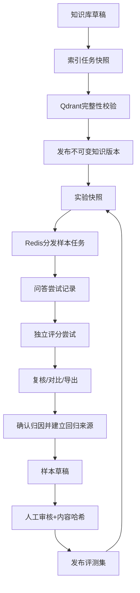

# V0.2 技术增量与当前结构

## 1. 模块拆分

- fingerprints：资产、样本规范化内容哈希。
- services：模型连接、切分、向量索引、LangGraph与评分服务。
- tasks：实验分发、样本执行、索引、租约恢复。
- reports：指标、判定优先级与跨实验对齐。
- permissions：测试、复核与只读权限。
- views/serializers：HTTP协议、输入验证和发布事务。
- frontend/features：审核、报告、对比、样本详情与回归交互。

## 2. 新增数据表

| 模型 | 主要字段与用途 |
| --- | --- |
| SampleApproval | asset、sample_id、content_hash、approved、reason、reviewer、created_at；只追加 |
| ExecutionAttempt | result、phase、status、error_type、output、started_at、finished_at；保留每次调用 |
| IndexJob | asset、fingerprint、backend、snapshot、collection、status、error、lease_until |
| RegressionMembership | dataset、source_result、sample_id、reason、expected_fix、created_by；来源唯一 |
| ChatRecord | knowledge、question、config、trace、error、created_by；问答历史 |

Result新增scoring_status、scoring_error、lease_token、lease_until。模型迁移0002是实际结构来源。

## 3. 状态与恢复

样本pending→running→succeeded/execution_failed。问答成功、评分异常时保持succeeded并标记scoring_status=failed。重试评分只重用已有trace，不再次生成。每次调用按generation/scoring分别存尝试。实验完成表示执行结束，不能代表质量达标。

实验行锁约束运行中的样本数量，消息重复投递不会再次认领非pending样本。任务租约15分钟，写回携带随机令牌，过期Worker不能覆盖新认领结果。Beat每60秒重新投递待执行任务并回收过期租约；索引租约过期记失败，需创建新索引任务。

## 4. 评分与证据

正确性基于参考答案及关键条件，评分结果同时保存参考答案；有据性和引用支持性基于检索片段，非拒答通过判定必须给出存在的证据标识。找不到支持证据时不接受无依据的通过判定。模型结构或证据校验失败计为评分异常。

规则检查支持必须/禁止文本条件、拒答、引用存在性及同文档相邻片段覆盖。文本规则仍可能误判同义表达，允许人工复核。模型建议与人工归因分别保留。

## 5. 新增接口

| 方法与路径 | 作用 |
| --- | --- |
| GET /api/capabilities/ | 配置中的模型与提示词选项 |
| POST /api/assets/{id}/clone/ | 用version复制新草稿，审核重新进行 |
| GET /api/assets/{id}/preview/ | 文档与切分来源预览 |
| GET/POST /api/assets/{id}/index/ | 索引历史/创建任务，参数backend |
| GET/POST /api/assets/{id}/approve/ | 审核历史/提交sample_id、approved、reason |
| GET /api/assets/{id}/chat/ | 最近50条问答历史 |
| GET /api/experiments/{id}/compare/?other={id} | 双实验对比 |
| GET /api/experiments/{id}/export/?format=json或csv | 明细导出 |
| POST /api/experiments/{id}/retry/ | phase=execution/scoring，可选result_ids |
| GET/POST /api/regressions/ | 回归来源查询/加入草稿集 |

回归请求包含dataset、source_result、reason、expected_fix。必须是相同产品；质量失败需要最新人工复核为失败且归因已确认。加入回归集不会自动审核或发布。

## 6. 连接配置

LLM_BASE_URL/LLM_API_KEY/LLM_MODEL管理通义兼容生成；DEEPSEEK_*管理DeepSeek生成；EMBEDDING_*独立管理向量服务；JUDGE_*独立管理评分。密钥只在服务端从环境读取，实验快照保存端点、模型、环境变量名，不保存密钥。

Token Plan模型目录与默认按量模型不同，应采用实际可用模型名称。当前联调使用qwen3.6-plus并关闭思考模式获取稳定JSON。Token Plan不能替代Embedding端点。前端根据后台配置展示当前默认模型。

## 7. 参考资料

- [Celery任务与重试](https://docs.celeryq.dev/en/stable/userguide/tasks.html)
- [Qdrant向量](https://qdrant.tech/documentation/manage-data/vectors/)
- [阿里云连接与端点](https://help.aliyun.com/en/model-studio/more-tools)
- [通义JSON结构化输出](https://help.aliyun.com/en/model-studio/qwen-structured-output)
